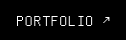

<picture>
  <source media="(prefers-color-scheme: dark)" srcset="assets/banner-dark.svg">
  
</picture>

Howdy! I'm a fullstack engineer. I like building things that are fast, feel good to use, and are worth coming back to.

  <a href="https://rmatsuda21.github.io/"><picture><source media="(prefers-color-scheme: dark)" srcset="assets/btn-portfolio-dark.svg"></picture></a>
  <a href="https://www.linkedin.com/in/reomatsuda/"><picture><source media="(prefers-color-scheme: dark)" srcset="assets/btn-linkedin-dark.svg"></picture></a>
  <a href="mailto:reo.matsuda@gmail.com"><picture><source media="(prefers-color-scheme: dark)" srcset="assets/btn-email-dark.svg"></picture></a>

<picture>
  <source media="(prefers-color-scheme: dark)" srcset="assets/stack-dark.svg">
  
</picture>

  

<picture>
  <source media="(prefers-color-scheme: dark)" srcset="assets/head-experience-dark.svg">
  
</picture>
<picture>
  <source media="(prefers-color-scheme: dark)" srcset="assets/figures-dark.svg">
  
</picture>

  

<picture>
  <source media="(prefers-color-scheme: dark)" srcset="assets/head-work-dark.svg">
  
</picture>
<a href="https://smash-ranker.vercel.app/"><picture><source media="(prefers-color-scheme: dark)" srcset="assets/work-001-dark.svg"></picture></a>
<a href="https://cstat-gacha-com.vercel.app/"><picture><source media="(prefers-color-scheme: dark)" srcset="assets/work-002-dark.svg"></picture></a>
<a href="https://pitch-io.vercel.app/"><picture><source media="(prefers-color-scheme: dark)" srcset="assets/work-003-dark.svg"></picture></a>
